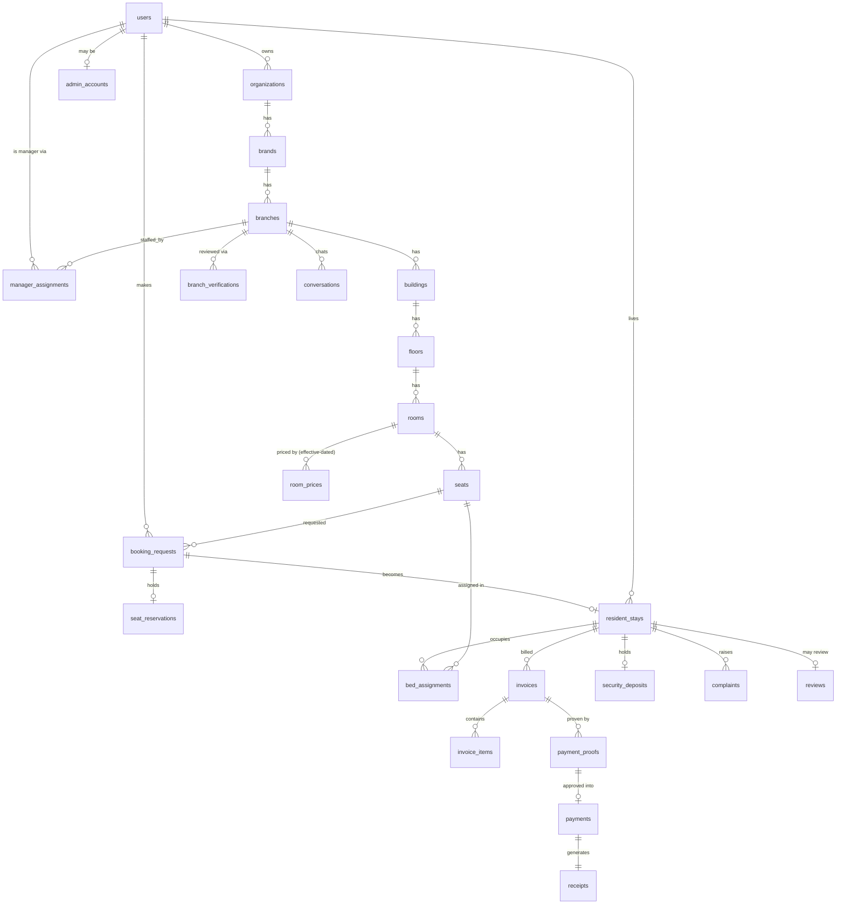

# 06: Database Schema (PostgreSQL 17 + PostGIS)

## Combined invoice origins (2026-11-22 / CHG-061 / AUD-004)

Migration 0088 makes resident_billing_origins primary key (execution_id, charge_id)
and replaces invoice uniqueness with an invoice lookup index. Charge uniqueness,
scoped foreign keys and immutable origin records remain. Each shared system invoice
has one exact audited origin per line, constrained by the live execution, primary
schedule item, authorized companion schedule and approved transport coverage.
Invoice face values remain immutable and are inserted once with the full total.

CHG-054 / CHG-004 (2026-11-18): migration 0079 adds nullable `residents.cnic_hash`
(HMAC, 32 bytes), `cnic_encrypted` (sealed envelope) and `cnic_last4`, all-or-none by
`residents_cnic_check`. The API encrypts; plain CNIC is never stored or logged. Booking
check-in copies the customer account's protected CNIC when present.

CHG-051 / RES-001 (2026-11-18): migration 0078 adds `resident_account_links` for
phone-match hostel confirmation. Each Stay/account pair has at most one request;
pending, approved, rejected and expired decisions retain timestamps and actor IDs.
Branch/Stay and account foreign keys enforce references. Approval updates resident
and current Stay IDs together; historical closed Stays are never backfilled.
See [SRS v2.35](srs/SRS-v2.35-resident-account-linking.md).

Admin completion (2026-10-30; TRUST-002/AUD-001/003, CHG020): generated0062 adds
verification_submissions (immutable dossier header), verification_snapshot_items
(complete pricing/photo children plus fingerprints), verification_decision_submissions
(decision-to-submission reference). FK/index/kind guards and UPDATE/DELETE rejection
preserve audit history. No inferred legacy backfill. Disposable tests pass; migration
is not applied to development and requires separate approval. See ADR0086/SRSv2.16.

- **Status:** v1 baseline history plus additive Phase 3 foundation models; implementation and verification boundaries are recorded in the checkpoints below.
- **Last updated:** 2026-10-20
- **Inputs:** SRS v2.0 p.46–47 (logical model) + every module page, `docs/srs/CHANGES.md` (CHG-001..014), `docs/03-domain-model.md`.

This document is the physical design that the Drizzle schema (`packages/db`) will implement. The DDL below is **pseudo-DDL**: it is precise about columns, types and constraints, but written for review rather than copy-paste.

## Local PostgreSQL replay repair (2026-10-23; ACC-001 / ACC-004)

Real PostgreSQL 17 replay on the new laptop reproduced SQLSTATE 42601 in
0009, then 0022 and 0030. With explicit user approval, five CASE expressions
in 0009/0022/0027/0030 receive parentheses so PL/pgSQL parses the existing
comparisons correctly. Guard conditions, financial calculations, schema,
journal order and timestamps are unchanged. This is syntax repair, not new
Phase 3 implementation or financial-policy approval.

These historical SQL files have new checksums. The local database was empty
and failed attempts rolled back. Never rewrite an existing database's recorded
checksums to hide a mismatch; reconcile any previously applied history before
using these files there. See NEW_LAPTOP_SETUP_REPORT.md for actual replay results.

---

## Phase 3 implementation checkpoint (CHG-009)

The original sections below remain baseline design history. Actual additive Drizzle
models now include `residents`, `stays`, `stay_history`, `stay_assignments`,
`billing_policies` and `stay_agreements` (generated migration0018; PostgreSQL
history/exclusion guards0019). Existing0000..0017 are preserved.

- A resident is a branch relationship, optionally explicitly linked to one account.
  Matching contacts never merge identities. Scoped foreign keys bind stays to the
  exact resident/account/booking lineage; partial unique indexes permit one active
  stay per linked customer across branches and one per branch-local resident.
- Booking state remains a reservation state. Stay state/version records actual
  lifecycle; terminal records cannot be reopened or deleted. Check-in timestamps
  and original source remain immutable. Commands must add audit/outbox atomically.
- Assignments retain actual timestamp intervals and exact room/type/seat lineage.
  GiST exclusions protect physical occupancy and same-stay history, including
  whole-room versus bed conflicts and half-open adjacent transfers. Closed
  assignment rows cannot be rewritten. A planned departure never closes occupancy.
- Billing policy versions have platform/brand/branch/room-type scopes and no
  financial defaults. Agreement versions retain integer paisa, effective dates,
  full terms/disclosed fees and the original booking snapshot. They are append-only.

This is foundation code, not a completed admission service. Wiring assignments into
existing inventory-claim lineage, mandatory transaction completeness, repositories,
HTTP routes, finance records and UI remains in progress. Never enable admission
using these tables alone. Real migrations, PostgreSQL constraints/concurrency and
rollback tests are NOT RUN LOCALLY; authored Testcontainers cases are acceptance
requirements, not a substitute for their execution. Index definitions do not prove
planner use.

### Explicit disclosed-fee policy JSON (CHG-011 / ADR0049)

New explicit billing policy versions may include feeBilling with a one-time due
offset and a complete optional monthly cycle/proration. Agreements preserve the
exact selected policy JSON and original fee disclosure. Absent timing remains
unconfigured, never an inferred weekly/monthly conversion. Existing rows and all
physical migrations remain unchanged; see the SRS v2.6 migration note. The shared
fee planner is a calculation boundary, not posted ledger/scheduler acceptance.

### Assignment inventory lineage checkpoint (ADR0045)

Generated0025/0026 extend `inventory_claims` with the scoped assignment source and
nullable upper dates exclusively for Stay claims. Existing GiST room/slot/date
conflict checks cover all four sources. Custom0027 checks exact claim periods,
atomic assignment closure/release and confirmed-booking handoff. Extension replaces
reservation history without overwriting actual timestamp assignment history.

Booking remains confirmed as original reservation history after check-in; linked
Stay fulfillment owns subsequent lifecycle. Legacy cancellation rejects checked-in
bookings. Current-date availability includes an unclosed actual occupant even after
expected departure; a stale departure plan also blocks new future reservations
until explicitly updated or checked out. Open-ended claims remain unbounded. Public results contain no
resident/assignment or financial data. Future conflict resolution never silently
cancels another booking or checks out an occupant. See ADR0045 for precise semantics.

This is in progress; admission services, billing schedules, HTTP/UI and actual
PostgreSQL acceptance remain required before completion.

### Resident finance persistence checkpoint (FIN-001 / PAY-008 / CHG-009)

Additive migrations0020..0023 introduce immutable charge/catalog/typed adjustment,
invoice/charge-link, approved external-payment/receipt/reversal, fund-movement and
ledger records. These are authored foundations; financial HTTP commands are not
implemented or enabled by these tables.

- Ledger entries retain their exact scoped source and original funding payment.
  Invoice allocations are receivable credit entries, not a second mutable total.
  Receipt snapshots must reproduce the original approved payment and distribution.
- Deposits and advance credits are separate accounts. Deferred checks reject
  negative funds, incomplete postings, excess allocations and incomplete reversals.
  An invoice void requires balancing credits; original invoice face value survives.
- Catalog records retain immutable unit labels/prices. Custom charges require the
  exact catalog snapshot disclosed in an agreement and integer quantity times price.
  Later price changes require a new catalog record and explicit agreement amendment.
- The protected `resident_finance_checks` table is an internal per-transaction
  validation queue. Only validation removes its ephemeral rows; financial history
  is retained. See ADR0044 for source and completeness invariants.
- Migration0023 adds required unit-price/quantity columns without guessed defaults.
  These new, unpublished tables are empty on the approved migration path. Any
  manually populated experimental deployment must supply explicit correct values
  before applying0023; never invent historical rates or quantities.

Migration0024 verifies an agreement's selected policy belongs to its actual
hostel/branch and verified assignment or original booking room type. Snapshot
policy and prices must equal selected facts; catalog entries must match live,
scoped immutable catalog records. Later policy changes never rewrite agreements.

Static journal/snapshot and historical-file integrity is checked locally. SQL
execution, clean replay/seed, constraints and real concurrency tests remain
NOT RUN LOCALLY / NOT VERIFIED until the compatible container acceptance run.

### Scheduled billing metadata checkpoint (RENT-004 / ADR0048)

Generated0029 adds resident_billing_schedules and resident_billing_executions.
Schedules bind the exact branch/Stay/agreement and real human authorization
audit, with explicit item/cadence, positive revision, bounded cursor and paired
current work/due instant. Execution records bind the same scope, actual internal
outbox job/lease proof, typed outcome and optional exact charge/invoice facts.
Unique item/revision/job/completed-period identities prevent conflicting metadata.
Amounts remain bounded bigint paisa; no payment or receipt is fabricated.

Custom0030 protects history, authorization/work identity, live execution leases
and deferred system audit/acknowledgement/schedule completion in both directions.
A cursor cannot advance without its real completed execution; an exact human
audit is required for allowed same-cursor resume/stop/supersession changes. New supporting
audit and charge uniqueness precedes dependent foreign keys in0029.
Existing0000..0028 and mandatory human charge/invoice actors are preserved.
These are unused foundations: actorless financial posting, schedule mutation
HTTP services, admission and registered billing worker processing remain
disabled/pending. Real Testcontainers cases are authored, NOT RUN LOCALLY; SQL
execution, clean replay/seed and real concurrency remain NOT VERIFIED.

### Guard-first scheduled source relation (AUD-004 / ADR0048)

Historical checkpoint before the approved0033 transition documented at the end of this file.

Additive0031 adds resident_billing_origins, a private immutable one-to-one
execution/charge/invoice relation bound to branch/Stay/agreement. Custom0032
prepares exact source and deferred completion/exclusive-origin guards. Human
posting/issuing actor NOT NULL constraints remain unchanged. This relation cannot
be used to relabel human financial history, and scheduled monetary writes remain
disabled. Eight new real cases (current60/4 foundation total) are NOT RUN LOCALLY.
Actor-nullability changes are a separately reviewed step; current source does
not implement that transition or claim real SQL/worker/CI acceptance.

## 1. Conventions

| Topic                  | Rule                                                                                                                                                                |
| ---------------------- | ------------------------------------------------------------------------------------------------------------------------------------------------------------------- |
| Naming                 | `snake_case`, plural table names, FK columns `<entity>_id`                                                                                                          |
| Primary keys           | `id uuid` (UUIDv7, generated by the app; time-ordered, so index-friendly). Never exposed as a human code                                                            |
| Display codes          | Separate human codes where needed (`INV-F8-000123`, `RCP-00182`), unique per branch, never used as FKs                                                              |
| Timestamps             | `timestamptz` everywhere; `created_at`, `updated_at` default `now()`. Displayed in `Asia/Karachi`                                                                   |
| Dates                  | `date` for calendar concepts (move-in date, billing month, due date)                                                                                                |
| Money                  | `bigint` **paisa** (PKR × 100), columns suffixed `_paisa`, `CHECK (>= 0)` unless explicitly signed. **Never float/numeric**                                         |
| Soft delete            | `archived_at timestamptz` on anything history may reference. **No hard deletes** of referenced rows (AUD-004, PROP-001)                                             |
| Enums                  | Postgres enums (`pgEnum` in Drizzle) for state machines. New values are added by migration; never remove values                                                     |
| Geo                    | `geography(Point, 4326)` + GIST index for every location                                                                                                            |
| Text case              | `citext` for emails and slugs                                                                                                                                       |
| Branch scoping         | **Every branch-owned table carries `branch_id`** (denormalised even when derivable), so the scope guard and indexes work without joins                              |
| Cross-parent integrity | Composite FKs make children match their parent's branch, e.g. `seats(branch_id, room_id) → rooms(branch_id, id)`. This needs `UNIQUE (branch_id, id)` on the parent |
| Status history         | Every important state machine has a `*_status_history` table (from, to, actor, reason, at)                                                                          |
| Audit                  | Privileged actions are written to `hostel_audit_log` / `platform_audit_log` **in the same transaction**                                                             |
| Sensitive data         | CNIC is stored as HMAC hash (for uniqueness) + encrypted value (for display) + last 4 digits (for masking). Never in plaintext                                      |

### Legend for the DDL below

`PK` primary key · `FK→t` foreign key · `U` unique · `?` nullable (columns are NOT NULL unless marked `?`) · `idx` index.

---

## 2. High-level ERD



---

## 3. Domains & tables

### 3.1 Identity & authentication (AUTH-C, AUTH-M, CHG-002, CHG-004)

**One person = one `users` row.** Customer, Owner, Manager and Admin are capabilities attached to that identity (p.6), not separate accounts.

```
users
  id                    uuid PK
  full_name             text
  email                 citext?  U            -- required for customers/owners/admins; managers may start with phone only
  email_verified_at     timestamptz?
  phone_e164            text?    U            -- normalised "+923001234567"
  phone_verified_at     timestamptz?          -- stays null in MVP (SMS OTP deferred, CHG-002)
  password_hash         text?                 -- argon2id; null for unclaimed walk-in identities
  gender                gender_enum?          -- male | female
  date_of_birth         date?                 -- enforces 18+ (AUTH-C-003)
  cnic_hash             bytea?   U            -- HMAC-SHA256(normalised 13 digits, server key)
  cnic_encrypted        bytea?                -- AES-GCM, for authorised display only
  cnic_last4            char(4)?              -- masked display (CHG-004)
  permanent_address     text?                 -- required before booking (AUTH-C-005); sensitive
  profile_photo_file_id uuid? FK→files
  account_status        account_status_enum   -- unclaimed | active | suspended | banned | deactivated
  created_at, updated_at, last_login_at?
```

- `unclaimed` = created by management for a walk-in (RES-003). Claimed later when the person signs up with a matching CNIC/phone/email (RES-002, walk-in uniqueness p.25).
- **Q10 resolved by design:** one identity can be an Owner/Manager and a Customer/Resident at once.

```
customer_profiles                 -- marketplace-specific, 1:1 with users
  user_id              uuid PK FK→users
  university_place_id  uuid? FK→places
  employer_place_id    uuid? FK→places
  institution_text     text?             -- free text when not in master list
  age                  smallint?         -- CHG-006: editable 18..120; historical null retained
  desired_area_id      uuid? FK→areas
  profile_completed_at timestamptz?
```

```
email_otps                        -- ADR 0002
  id            uuid PK
  user_id       uuid? FK→users
  email         citext
  purpose       otp_purpose_enum      -- signup_verify | password_reset | email_change
  code_hash     text
  attempts      smallint default 0    -- max 5
  expires_at    timestamptz           -- now()+10 min
  consumed_at   timestamptz?
  request_ip    inet?
  created_at
  idx (email, purpose, created_at desc)
```

```
sessions                          -- DB-backed refresh tokens; instant revocation (MGR-004)
  id                     uuid PK
  user_id                uuid FK→users
  refresh_token_hash     text U
  client                 client_enum      -- mobile | web
  device_label           text?
  ip                     inet?
  user_agent             text?
  created_at, last_used_at
  expires_at             timestamptz
  revoked_at             timestamptz?
  revoked_reason         text?            -- logout | rotated | manager_deactivated | password_reset | admin_action
  replaced_by_session_id uuid? FK→sessions
  idx (user_id) where revoked_at is null
```

Access JWTs are short-lived (~10 min). Every privileged request also re-checks the current role/assignment state (p.37 "session behavior").

```
push_tokens
  id uuid PK, user_id FK→users, expo_push_token text U, platform (android|ios), last_seen_at, created_at
```

### 3.2 Ownership, brands, branches & staff (BRN, MGR, CHG-003)

```
organizations                    -- "OwnerOrganization"
  id              uuid PK
  owner_user_id   uuid FK→users        -- MVP: one owner per organisation
  name            text
  created_at, updated_at, archived_at?
  idx (owner_user_id)

brands                           -- "Hostel / Brand"
  id              uuid PK
  organization_id uuid FK→organizations
  name            text
  logo_file_id    uuid? FK→files
  created_at, updated_at, archived_at?

branches                         -- operational unit, the scope boundary
  id                    uuid PK
  organization_id       uuid FK→organizations   -- denormalised for owner scope checks
  brand_id              uuid FK→brands
  name                  text
  slug                  citext U                -- public URL
  category              hostel_category_enum?   -- boys | girls | working_male | working_female
  city_id               uuid? FK→cities
  area_id               uuid? FK→areas
  sub_area_id           uuid? FK→areas
  address_line          text?                   -- public once approved (p.12)
  location              geography(Point,4326)?  -- authoritative coordinates
  description           text?
  nearby_landmark       text?                   -- optional main-branch guidance
  public_phone          text?
  public_email          citext?
  show_public_contact   boolean default false   -- COMM-001
  mess_included         boolean default false
  mess_notes            text?
  verification_status   verification_status_enum  -- draft | submitted | under_review | changes_requested | approved | rejected | suspended
  first_approved_at     timestamptz?
  listing_hidden_at     timestamptz?            -- admin safety hide (ADM-007), internal data untouched
  is_primary            boolean default false   -- main branch; one live primary per brand
  plan_status           plan_status_enum default 'free'   -- CHG-003: only 'free' used in MVP
  completeness_score    smallint?               -- internal only (TRUST-004)
  rating_avg            numeric(3,2)?           -- cached; excludes hidden reviews (p.35)
  rating_count          integer default 0
  created_at, updated_at, archived_at?
  U (organization_id, id)  -- for composite FKs
  idx GIST (location); idx (city_id, area_id); idx (verification_status)

branch_settings                  -- 1:1, all "manager-configurable" values with safe defaults (p.2)
  branch_id                          uuid PK FK→branches
  reservation_expiry_hours           integer default 48   -- BKG-006/010
  upfront_requirement                upfront_enum default 'none'  -- none | deposit | first_rent | deposit_and_first_rent (BKG-007)
  proof_retry_allowed                boolean default true
  partial_payments_enabled           boolean default false     -- RENT-005
  rent_due_day                       smallint default 5        -- 1..28 (Q9 still open)
  grace_days                         smallint default 3
  late_fee_type                      late_fee_type_enum default 'disabled'  -- disabled | fixed | percentage | manual
  late_fee_value                     bigint?                   -- paisa for fixed; basis points for percentage
  notice_period_days                 smallint default 30       -- OUT-001
  booking_request_response_hours    integer default 24        -- performance metric
  updated_at, updated_by_user_id

manager_assignments              -- MGR-*, AUTH-M-*
  id                       uuid PK
  user_id                  uuid FK→users
  branch_id                uuid FK→branches
  status                   manager_status_enum   -- pending_activation | active | suspended | deactivated
  temp_password_hash       text?                 -- single-use, 24h (AUTH-M-003)
  temp_password_expires_at timestamptz?
  temp_password_attempts   smallint default 0
  appointed_by_user_id     uuid FK→users         -- must be the branch owner
  activated_at, suspended_at, deactivated_at  timestamptz?
  status_reason            text?
  created_at, updated_at
  U (user_id) WHERE status <> 'deactivated'      -- BR-04: one live branch per manager
  idx (branch_id, status)
```

Activation sets `users.password_hash`. If the invited phone already belongs to a customer, the assignment attaches to that existing user (p.9 invite collision).

### 3.3 Geography & reference places (GEO)

```
cities
  id uuid PK, name text, slug citext U, is_active boolean, sort_order

areas                            -- zones / areas / sectors / sub-areas in one tree
  id             uuid PK
  city_id        uuid FK→cities
  parent_id      uuid? FK→areas      -- trigger ensures parent.city_id = city_id (p.12 hierarchy)
  level          area_level_enum     -- zone | area | sector | sub_area
  name           text
  slug           citext
  centroid       geography(Point,4326)?
  is_active      boolean
  U (city_id, slug)

places                           -- every searchable point (GEO-003, CHG-033)
  id            uuid PK
  type          place_type_enum      -- university | office | business_hub | school | health
                                     -- | hotel | food | government | library | locality
                                     -- (migration 0070; OpenStreetMap imports use slug osm-*)
  name          text
  short_name    text?                -- "NUST", "FAST"
  slug          citext U             -- university landing pages
  city_id       uuid FK→cities
  area_id       uuid? FK→areas
  address       text?
  location      geography(Point,4326)   -- authoritative for distance
  is_active     boolean
  idx GIST (location)

search_aliases                   -- alternate spellings (p.12)
  id uuid PK, target_type (area|place|city), target_id uuid, alias citext
  idx (alias) using gin trigram
```

Distance search uses `ST_DWithin(branches.location, place.location, radius_m)` with 1/3/5/10 km radii (GEO-004).

### 3.4 Property structure, pricing & media (PROP, ROOM, SEAT)

AUD-010 runtime checkpoint (2026-10-28; RPT-001/002, SEC-003): generated migration
0059 implements the previously missing buildings/floors hierarchy. Both tables
include positive integer `version` (default 1), creation/update timestamps and
nullable archival time. Names/labels are nonempty; floors retain a smallint level.
`rooms.floor_id` is nullable for existing unclassified rooms and uses the composite
branch/floor foreign key. `rooms.location_version` starts at 1 and guards metadata
corrections independently of physical room lifecycle. Parent/page indexes support
bounded named lookups. No invented backfill or financial/state changes. Archive
retains referenced rows and existing availability. See
[migration note](migrations/0059-report-property-structure.md) and
[management contract](api/09-property-report-prerequisite.md). Fresh and previous-
schema upgrade verification passes on disposable PostgreSQL; no existing
environment database has been migrated. The pseudo-DDL below remains baseline
history; its nonnullable floor assumption is superseded by this additive rollout.

```
buildings
  id uuid PK, branch_id FK→branches, name text, sort_order, archived_at?
  U (branch_id, id)

floors
  id uuid PK, branch_id, building_id, label text, level_number smallint, archived_at?
  FK (branch_id, building_id) → buildings(branch_id, id)
  U (branch_id, id)

room_types                       -- configurable names (p.18)
  id uuid PK, branch_id FK→branches, name text, archived_at?

rooms
  id                     uuid PK
  branch_id              uuid
  floor_id               uuid
  room_type_id           uuid? FK→room_types
  room_number            text
  capacity               smallint CHECK (capacity between 1 and 20)
  description            text?
  expected_vacancy_date  date?          -- WAIT-001
  is_active              boolean default true
  created_at, updated_at, archived_at?
  FK (branch_id, floor_id) → floors(branch_id, id)
  U (branch_id, id)
  U (branch_id, room_number) WHERE archived_at IS NULL
```

**PROP-002:** lowering `capacity` below the number of seats with an active assignment is rejected. The service checks this inside a transaction that locks the room row.

```
room_prices                      -- effective-dated pricing (p.18 "price effective date")
  id                      uuid PK
  branch_id               uuid
  room_id                 uuid
  pricing_model           pricing_model_enum    -- per_seat | per_room
  monthly_rent_paisa      bigint CHECK (> 0)
  security_deposit_paisa  bigint CHECK (>= 0)
  effective_from          date
  created_by_user_id      uuid
  created_at
  FK (branch_id, room_id) → rooms(branch_id, id)
  U (room_id, effective_from)
```

Current price = row with the latest `effective_from <= today`. Bookings and invoices **copy** the amount; they never reference the price row for money (BKG-004, RENT-003).

Phase3 runtime refinement (2026-10-25; ADR0069, SRS v2.10): the above room_prices
block remains the historical v1 plan. Implemented rooms share configurable
room_types, so additive0048/0049 provide room_type_prices keyed by branch/type
and unique(type,effective_from). Each immutable version stores bigint bed/room
rent, deposit and one validated integer-paisa disclosed-fee JSON snapshot, creator
and creation time. Exact composite foreign keys, immutable update/delete/truncate
guards and inventory-mode checks retain source/history integrity. The
current_room_types view resolves the latest due date using Asia/Karachi and
falls back to legacy configured prices until a version is due. No legacy date
backfill or financial snapshot rewrite. Management reads and public projections
use this view; quote creation retains base inventory locks and resolves the same
version with its clock. Private history/creator fields never become public DTOs.

```
seats                            -- "Seat" and "Bed" are synonyms (p.2); DB term = seat
  id                uuid PK
  branch_id         uuid
  room_id           uuid
  label             text                 -- "B1"
  state             seat_state_enum      -- available | reserved | occupied | maintenance (BED-001)
  listed_publicly   boolean default false -- manager intent to publish (ROOM-003)
  state_changed_at  timestamptz
  created_at, updated_at, archived_at?
  FK (branch_id, room_id) → rooms(branch_id, id)
  U (branch_id, id)
  U (room_id, label) WHERE archived_at IS NULL
  idx (branch_id, state)
```

- `state` is changed **only** by the bed-board/booking/checkout services, in the same transaction as the assignment/reservation change. `occupied` ⇔ an open `bed_assignments` row exists (SEAT p.19 occupancy truth). A nightly consistency check reports any drift.
- **Publicly selectable** (computed, not stored) = `state='available' AND listed_publicly AND` the room has ≥1 approved room photo `AND` the seat has an approved seat photo `AND` the branch is `approved`, not hidden, not archived (ROOM-003, SEAT-002).

```
files                            -- every uploaded object (S3-compatible storage)
  id               uuid PK
  uploaded_by      uuid? FK→users
  visibility       file_visibility_enum   -- public | private
  bucket           text
  object_key       text U
  mime_type        text
  size_bytes       bigint
  sha256           bytea                  -- duplicate detection
  purpose          file_purpose_enum      -- listing_photo | payment_proof | resident_document | verification_document | chat_attachment | complaint_attachment | receipt_pdf | export | avatar | import
  scan_status      scan_status_enum default 'pending'  -- pending | clean | rejected
  created_at
```

Private files are served only through short-lived signed URLs, after an authorisation check (SEAT-004, SEC-003).

Phase 1 clarification: `files.sha256` is nullable while an upload is pending/rejected;
server validation must populate a 32-byte digest before `scan_status = clean`. The
database enforces that condition. Presigning cannot know the validated object digest.

```
listing_photos
  id                  uuid PK
  branch_id           uuid FK→branches
  scope               photo_scope_enum     -- hostel | room | seat | menu
  room_id             uuid?
  seat_id             uuid?
  file_id             uuid FK→files
  caption             text?
  sort_order          smallint
  moderation_status   moderation_enum      -- pending | approved | rejected (TRUST-003)
  moderation_reason   text?
  moderated_by        uuid? FK→users
  archived_at         timestamptz?         -- replaced photos kept for moderation history (p.19)
  CHECK ((scope='room' AND room_id IS NOT NULL AND seat_id IS NULL)
      OR (scope='seat' AND seat_id IS NOT NULL)
      OR (scope IN ('hostel','menu') AND room_id IS NULL AND seat_id IS NULL))

amenities          id, code U, name, applies_to (branch|room), icon     -- seeded: parking, AC, Wi-Fi, CCTV, … (p.13, ROOM-005)
branch_amenities   (branch_id, amenity_id) PK
room_amenities     (room_id, amenity_code) PK, branch_id; used when rooms.amenities_customized (CHG-019, migration 0061)

hostel_rules       id, branch_id, body text, sort_order, archived_at?
visiting_hours     id, branch_id, day_of_week smallint (0-6), opens_at time, closes_at time

cancellation_policies          -- versioned & immutable once used (p.21 policy version)
  id uuid PK, branch_id, version integer, body text, created_by, created_at
  U (branch_id, version)
  branches.current_cancellation_policy_id uuid? FK (added column)

branch_payment_methods         -- where residents pay directly (PAY-003, BKG-007)
  id              uuid PK
  branch_id       uuid FK→branches
  method          payment_method_enum   -- bank_transfer | jazzcash | easypaisa | raast | card | cash
  account_title   text?
  account_number  text?
  bank_name       text?
  iban            text?
  instructions    text?
  is_active       boolean
  created_at, updated_at, archived_at?
```

```
import_runs                    -- CSV/Excel bulk setup (p.16–17); baseline name superseded below
  id uuid PK, branch_id, kind (rooms|seats|residents|opening_balances),
  file_id FK→files, file_sha256 bytea,
  status (validated|committed|failed), total_rows, error_rows, errors jsonb,
  created_by, created_at, committed_at?
  U (branch_id, kind, file_sha256) WHERE status = 'committed'   -- idempotent re-upload
```

Imports validate everything first, then commit in one transaction. Malformed rows never create partial records.

Phase3 runtime uses additive0046 `inventory_import_runs`: branch/kind/file SHA256,
validated/failed/committed status, bounded immutable row-preview JSON (1..500 CSV
records), total/error counts, creator/time and optional commit time. Room/seat
imports only; later resident/opening-balance execution remains outside Phase3.
The committed digest is unique per branch/kind; branch/file/creator indexes support
scope and references. Additive0047 rejects source/preview rewrites, deletion and
truncate; only validated→committed with a commit time is allowed. Source files
must be private clean CSV from the recorded uploader and matching SHA256; linked
file metadata/digest cannot change. Scan rejection remains possible and prevents
new commit. Every commit revalidates current scoped inventory inside the audited
transaction. Existing migration SQL and historical records remain preserved.

### 3.5 Listing verification (TRUST, ONB)

```
branch_verifications           -- one row per submission (versioned, p.15 reapproval)
  id                    uuid PK
  branch_id             uuid FK→branches
  submission_no         integer
  status                verification_status_enum
  submitted_by_user_id  uuid
  submitted_at          timestamptz
  listing_snapshot      jsonb          -- what was submitted, so approved vs pending can be compared
  reviewer_user_id      uuid? FK→users (admin)
  decided_at            timestamptz?
  decision_reason       text?
  U (branch_id, submission_no)

verification_documents
  id uuid PK, verification_id FK, file_id FK→files (private),
  doc_type (owner_cnic | ownership_deed | lease_agreement | utility_bill | other), created_at

verification_status_history
  id, branch_id, verification_id?, from_status?, to_status, actor_user_id?, reason?, created_at
```

### 3.6 Booking, visits, chat & waiting list (BKG, VISIT, COMM, WAIT)

```
booking_requests
  id                         uuid PK
  branch_id                  uuid
  customer_user_id           uuid FK→users
  room_id                    uuid
  seat_id                    uuid
  status                     booking_status_enum
     -- draft | submitted | under_review | approved | payment_pending | verification_pending
     -- | confirmed | checked_in | completed | rejected | withdrawn | expired | cancelled
  move_in_date               date
  expected_leave_date        date?
  -- price snapshot (BKG-004, p.21 application snapshot)
  pricing_model              pricing_model_enum
  monthly_rent_paisa         bigint
  security_deposit_paisa     bigint
  upfront_requirement        upfront_enum
  upfront_amount_paisa       bigint
  cancellation_policy_id     uuid? FK→cancellation_policies
  policy_acknowledged_at     timestamptz?          -- p.22 cancellation disclosure
  submitted_at               timestamptz?
  first_response_at          timestamptz?          -- response-time metric (p.39)
  decided_by_user_id         uuid?
  rejection_reason           text?                 -- required when rejected (BKG-002)
  offer_expires_at           timestamptz?
  created_at, updated_at
  FK (branch_id, seat_id) → seats(branch_id, id)
  U (customer_user_id, seat_id) WHERE status IN (<active statuses>)   -- no duplicate request for one seat
  idx (branch_id, status, submitted_at)
  idx (customer_user_id, status)
```

- **Active statuses** = submitted, under_review, approved, payment_pending, verification_pending.
- **BKG-001 (max 3 active):** enforced in the service. The transaction takes `SELECT … FOR UPDATE` on the customer's `users` row, counts active requests, then inserts. A plain constraint cannot express a count limit.
- **Eligibility (p.21):** the branch category must match the customer's gender, validated server-side.
- **CHG-004:** until `status >= approved`, the management API returns only `cnic_last4` and no permanent address.

```
booking_status_history
  id, booking_id FK, from_status?, to_status, actor_user_id? (null = system),
  rule_applied text?   -- e.g. "reservation_expiry_hours=48" (p.22 expiry logging)
  reason text?, created_at

seat_reservations              -- BKG-009/010
  id              uuid PK
  branch_id       uuid
  seat_id         uuid
  booking_id      uuid FK→booking_requests U
  status          reservation_status_enum  -- active | released | converted
  expires_at      timestamptz
  released_at     timestamptz?
  release_reason  text?          -- expired | withdrawn | rejected | cancelled
  created_at
  U (seat_id) WHERE status = 'active'          -- one live reservation per seat
  idx (expires_at) WHERE status = 'active'     -- expiry job
```

```
visit_requests
  id uuid PK, branch_id, customer_user_id,
  requested_start timestamptz, proposed_start timestamptz?,
  status (requested | approved | rescheduled | rejected | cancelled | completed | no_show),
  decided_by_user_id?, reason?, follow_up_sent_at? (VISIT-001), created_at, updated_at

waiting_list_entries
  id uuid PK, branch_id, customer_user_id, room_type_id?,
  status (active | notified | cancelled | fulfilled), last_notified_at?, created_at
  U (customer_user_id, branch_id, COALESCE(room_type_id, '00000000-…')) WHERE status IN ('active','notified')
  -- never auto-books (p.23)

favorites
  (user_id, branch_id) PK, created_at

conversations                  -- one thread per customer per branch
  id uuid PK, branch_id, customer_user_id, last_message_at, created_at
  U (branch_id, customer_user_id)

chat_messages
  id uuid PK, conversation_id FK, sender_user_id FK→users,
  sender_side (customer | branch), body text?, created_at, deleted_at?
  idx (conversation_id, created_at)

chat_attachments
  message_id FK, file_id FK→files   -- only delivered once files.scan_status = 'clean'

conversation_reads
  (conversation_id, user_id) PK, last_read_at
```

### 3.7 Residents & bed board (STAY, RES, BED)

```
resident_stays
  id                       uuid PK
  branch_id                uuid
  user_id                  uuid FK→users       -- may be 'unclaimed' for walk-ins
  booking_id               uuid? FK→booking_requests U
  source                   stay_source_enum    -- booking | walk_in | import
  status                   stay_status_enum    -- upcoming | active | checkout_requested | checked_out | cancelled
  university_or_employer   text?               -- snapshot for the resident record
  checked_in_at            timestamptz?
  checked_in_by_user_id    uuid?
  expected_leave_date      date?               -- planning data (p.25)
  checkout_requested_at    timestamptz?
  requested_checkout_date  date?
  is_emergency_checkout    boolean default false
  checked_out_at           timestamptz?
  checked_out_by_user_id   uuid?
  created_at, updated_at
  U (user_id) WHERE status IN ('active','checkout_requested')   -- BR-03 / STAY-003
  U (branch_id, id)
  idx (branch_id, status)
```

```
bed_assignments                -- who sits in which seat, over time
  id                 uuid PK
  branch_id          uuid
  stay_id            uuid
  seat_id            uuid
  started_at         timestamptz
  ended_at           timestamptz?
  end_reason         assignment_end_enum?   -- transfer | checkout | correction
  created_by_user_id uuid
  FK (branch_id, stay_id) → resident_stays(branch_id, id)
  FK (branch_id, seat_id) → seats(branch_id, id)
  U (seat_id) WHERE ended_at IS NULL     -- ACC-001: never two residents on one seat
  U (stay_id) WHERE ended_at IS NULL     -- one resident cannot hold two seats (p.20)

bed_transfers                  -- RES-005
  id uuid PK, branch_id, stay_id,
  from_assignment_id FK→bed_assignments, to_assignment_id FK→bed_assignments,
  reason text, actor_user_id, created_at

resident_contacts              -- guardian / emergency (p.25)
  id uuid PK, branch_id, stay_id, kind (guardian | emergency), name, relation?, phone_e164

resident_documents
  id uuid PK, branch_id, stay_id, file_id FK→files (private),
  doc_type (agreement | cnic_image | student_card | employee_card | police_verification | other),
  uploaded_by_user_id, created_at, archived_at?

agreement_versions
  id uuid PK, branch_id, version integer, body text, created_at  U (branch_id, version)

agreement_acceptances          -- p.25 agreement versioning
  id uuid PK, stay_id, agreement_version_id, accepted_at, accepted_via (app | in_person), ip inet?
```

**Atomic operations** (single transaction, `SELECT … FOR UPDATE` on seat rows, re-validate state):

| Operation         | Writes                                                                                                                  |
| ----------------- | ----------------------------------------------------------------------------------------------------------------------- |
| Check-in          | stay → active · new bed_assignment · seat → occupied · reservation → converted · booking → checked_in · history · audit |
| Walk-in           | user (find by CNIC hash/phone/email or create unclaimed) · stay(active) · assignment · seat → occupied · audit          |
| Transfer          | end old assignment · new assignment · old seat → available · new seat → occupied · bed_transfers · audit                |
| Checkout complete | end assignment · seat → available · stay → checked_out · booking → completed · final statement · audit                  |

### 3.8 Rent & finance (RENT, PAY, RB, FIN, COLL)

```
invoices
  id                 uuid PK
  branch_id          uuid
  invoice_no         text                  -- display code, U (branch_id, invoice_no)
  user_id            uuid FK→users         -- payer
  stay_id            uuid?                 -- null for booking-upfront invoices before check-in
  booking_id         uuid?
  kind               invoice_kind_enum     -- monthly_rent | booking_upfront | final_settlement
  billing_month      date?                 -- first day of month, for monthly_rent
  issue_date         date
  due_date           date
  overdue_after      date                  -- due_date + grace_days (snapshot)
  total_paisa        bigint                -- sum of non-voided items (may be adjusted by discount items)
  paid_paisa         bigint default 0      -- sum of approved payments (cached, updated atomically)
  status             invoice_status_enum   -- issued | partially_paid | paid | void
  void_reason        text?
  created_at, updated_at
  U (stay_id, billing_month) WHERE kind = 'monthly_rent' AND status <> 'void'   -- deterministic generation (p.26)
  CHECK (paid_paisa <= total_paisa OR kind = 'final_settlement')
  idx (branch_id, billing_month, status)

invoice_items
  id                uuid PK
  invoice_id        uuid FK→invoices
  kind              invoice_item_kind_enum  -- rent | security_deposit | transport | late_fee | discount | adjustment | opening_balance
  description       text
  amount_paisa      bigint                  -- SIGNED: discount/adjustment credits are negative
  period_start      date?
  period_end        date?                   -- supports proration later (Q3)
  source_type       text?                   -- e.g. 'transport_subscription', 'discount'
  source_id         uuid?
  voided_at         timestamptz?            -- late-fee revocation etc. (FIN-002) — never deleted
  voided_by_user_id uuid?
  void_reason       text?
  created_by_user_id uuid?                  -- null = system generator
  created_at
```

Issued invoices are never rewritten (RENT-003). Corrections are added as new `adjustment` items or a voided-and-reissued invoice, both audited.

```
payment_proofs                 -- resident-submitted evidence (PAY-001..009)
  id                     uuid PK
  branch_id              uuid
  invoice_id             uuid FK→invoices
  submitted_by_user_id   uuid
  amount_paisa           bigint CHECK (> 0)
  method                 payment_method_enum
  transaction_ref        text?
  paid_on                date
  file_id                uuid FK→files (private)
  submission_token       uuid U              -- client idempotency (p.27 duplicate submit)
  status                 proof_status_enum   -- pending | approved | rejected
  reviewed_by_user_id    uuid?
  reviewed_at            timestamptz?
  rejection_code         proof_rejection_enum?  -- not_received | wrong_amount | wrong_transaction | unreadable | duplicate | other
  rejection_note         text?               -- required when code = other
  created_at
  idx (branch_id, status, created_at)        -- approval queue

payments                       -- the ONLY thing that makes money "paid" (ACC-004)
  id                     uuid PK
  branch_id              uuid
  invoice_id             uuid FK→invoices
  proof_id               uuid? FK→payment_proofs U   -- one payment per proof (approval idempotency)
  source                 payment_source_enum  -- proof_approval | recorded_by_management | opening_balance
  amount_paisa           bigint CHECK (> 0)
  method                 payment_method_enum
  transaction_ref        text?
  paid_on                date
  approved_by_user_id    uuid
  approved_at            timestamptz
  voided_at              timestamptz?        -- reversal; never deleted
  void_reason            text?
  created_at

receipts                       -- immutable snapshot (p.28, p.30)
  id             uuid PK
  branch_id      uuid
  payment_id     uuid FK→payments U
  receipt_no     text                -- "RCP-00182", U (branch_id, receipt_no)
  snapshot       jsonb               -- hostel, branch, resident, room/seat, month, amount, method, ref, dates, approver
  pdf_file_id    uuid? FK→files      -- generated by worker
  issued_at      timestamptz

credit_ledger                  -- "AdvanceBalance" as a traceable ledger (RENT-004, p.26)
  id                 uuid PK
  branch_id, stay_id
  amount_paisa       bigint      -- + credit created (overpayment/advance), − credit applied
  source_payment_id  uuid? FK→payments
  applied_invoice_id uuid? FK→invoices
  note               text?
  created_by_user_id uuid?, created_at
  -- balance = SUM(amount_paisa) per stay

discounts                      -- FIN-003
  id uuid PK, branch_id, stay_id, kind (fixed | percentage), value bigint,
  effective_from date, effective_to date?, reason text,
  approved_by_user_id, created_at, revoked_at?, revoked_by_user_id?

security_deposits              -- separate from rent income (p.30 deposit ledger)
  id                    uuid PK
  branch_id             uuid
  stay_id               uuid U
  required_paisa        bigint      -- snapshot from booking/room price (FIN-001)
  received_paisa        bigint default 0
  refund_status         refund_status_enum default 'not_due'   -- not_due | pending | completed
  refund_amount_paisa   bigint?
  refunded_at           timestamptz?
  refund_reference      text?
  refund_proof_file_id  uuid? FK→files
  updated_at

security_deductions
  id uuid PK, deposit_id FK, amount_paisa bigint CHECK (> 0), reason text,
  evidence_file_id uuid?, created_by_user_id, created_at, voided_at?
```

**Payment approval transaction (PAY-008)**, idempotent on `proof_id`:

1. Lock the proof (`FOR UPDATE`) and require `status = pending`. If already approved, return the existing payment and receipt.
2. Insert the `payments` row.
3. Update `invoices.paid_paisa` and `status`. Any overpayment goes to `credit_ledger`. Deposit items update `security_deposits.received_paisa`.
4. Insert the `receipts` row (number from a per-branch sequence).
5. Write the outbox rows (notification + PDF job), the audit row and the proof status update.
6. Commit.

**Rent Board state** (derived per seat for the selected month; never stored, RB-001..):

```
no open bed_assignment                                   → vacant  (silver)
invoice.status = paid                                    → paid    (green)
exists pending proof                                     → pending (yellow)    -- Q5 open: yellow wins over partial
partial_payments_enabled AND 0 < paid_paisa < total      → partial (orange)
today > overdue_after                                    → overdue (red)
else                                                     → due     (neutral)
```

### 3.9 Services: mess & transport (SERV)

```
menu_items
  id uuid PK, branch_id, day_of_week smallint, meal (breakfast | lunch | dinner),
  description text, photo_file_id uuid?, updated_at, updated_by_user_id
  U (branch_id, day_of_week, meal)

transport_routes
  id uuid PK, branch_id, name, monthly_charge_paisa bigint, departure_times text[],
  is_active boolean, created_at, archived_at?

transport_stops
  id uuid PK, route_id FK, name, location geography(Point,4326)?, sort_order, pickup_time time?

transport_subscriptions        -- p.32 charge lifecycle
  id uuid PK, branch_id, stay_id, route_id,
  status (requested | active | ended | rejected),
  monthly_charge_paisa bigint,     -- snapshot
  effective_from date?, effective_to date?, created_at, decided_by_user_id?
```

### 3.10 Complaints, checkout & reviews (CMP, OUT, REV)

```
complaints
  id                   uuid PK
  branch_id            uuid
  stay_id              uuid           -- must be an active stay at creation (CMP-006)
  user_id              uuid
  room_id, seat_id     uuid?          -- context
  category             complaint_category_enum  -- electricity | plumbing | wifi | cleaning | furniture | ac | geyser | mess | security | staff | other
  title                text
  description          text
  status               complaint_status_enum    -- open | assigned | in_progress | resolved | closed | reopened
  assigned_to_user_id  uuid?
  resolved_at, closed_at timestamptz?
  reopen_count         smallint default 0
  created_at, updated_at
  idx (branch_id, status)

complaint_attachments    complaint_id, file_id
complaint_status_history id, complaint_id, from_status?, to_status, actor_user_id, note?, created_at

checkout_statements            -- OUT-005 final statement (immutable once finalised)
  id uuid PK, branch_id, stay_id U,
  rent_due_paisa, payments_paisa, outstanding_paisa, advance_paisa,
  deposit_paisa, deductions_paisa, refund_paisa, final_balance_paisa  (bigint, signed where needed),
  snapshot jsonb, finalised_by_user_id, finalised_at

reviews                        -- REV-*
  id              uuid PK
  branch_id       uuid
  stay_id         uuid U          -- REV-003 one main review per stay
  user_id         uuid
  overall_rating  smallint CHECK (1..5)
  body            text?
  status          review_status_enum   -- published | hidden | removed
  moderation_reason text?
  created_at, edited_at?
  -- REV-002: service checks stay duration >= 30 days before insert

review_ratings     (review_id, category) PK, rating smallint CHECK (1..5)
                   -- category: cleanliness | security | food | staff | wifi | facilities | location | value | overall
review_revisions   id, review_id, previous_body, previous_ratings jsonb, edited_at   -- p.35 edit history
review_replies     id, review_id U, author_user_id, body, created_at, edited_at?     -- management cannot edit reviews
```

### 3.11 Communication & notifications (NTF)

```
notifications                  -- in-app inbox
  id uuid PK, user_id, branch_id?, type text, title, body, data jsonb,
  deep_link text?, dedupe_key text U, read_at?, created_at
  idx (user_id, read_at, created_at desc)

notification_outbox            -- written in the domain transaction; worker delivers
  id uuid PK, event_type text, channel (in_app | email | push | sms | internal),
  recipient_user_id uuid?, recipient_address text?, payload jsonb,
  dedupe_key text U,             -- one domain event → one delivery (p.43)
  status (pending | sent | failed | dead), attempts smallint, next_attempt_at,
  last_error text?, provider_message_id text?, created_at, sent_at?
  lease_token uuid?, lease_expires_at? -- both NULL or both set; same-token acknowledgement
  -- Worker row lock claims commit before delivery; five attempts, expiry recovery (ADR 0007).
  -- internal is infrastructure-only (files.scan), not a notification preference or client channel.
  -- File scan publication locks the file then outbox; both metadata and acknowledgement commit together.
  -- In-app publication locks the outbox, rechecks its current lease after locking, and commits the unique notice with acknowledgement (ADR 0012).
  idx (status, next_attempt_at)

notification_preferences
  (user_id, category, channel) PK, enabled boolean
  -- transactional/security categories cannot be disabled (NTF-002); enforced in service

announcements                  -- ADM-010
  id uuid PK, created_by_user_id, audience (all_managers | selected_branches | customers | city),
  audience_filter jsonb, title, body, scheduled_at?, sent_at?, created_at
```

### 3.12 Platform administration, moderation & support (ADM)

```
admin_accounts
  user_id            uuid PK FK→users
  is_root            boolean default false
  status             admin_status_enum   -- invited | active | suspended | deactivated
  invited_by_user_id uuid?
  created_at, updated_at

admin_role_grants              -- normal admins may hold several roles (ADM-003)
  id uuid PK, admin_user_id FK, role admin_role_enum,   -- verification | support | content_moderator | billing (billing unused until subscriptions)
  granted_by_user_id, granted_at, revoked_at?
  U (admin_user_id, role) WHERE revoked_at IS NULL
```

**Root cap (max 3, min 1):** root changes run under `pg_advisory_xact_lock(<root-admin-lock>)`. The service counts active roots and rejects a 4th, or the removal of the last one. A deferred constraint trigger double-checks (p.41).

```
reports                        -- user reports: listing, review, chat message, user
  id uuid PK, reporter_user_id, target_type (branch | review | chat_message | user),
  target_id uuid, reason (fake_listing | wrong_price | unsafe | harassment | scam | inappropriate_chat | spam | other),
  details text?, status (open | investigating | actioned | dismissed),
  handled_by_user_id?, resolution text?, created_at, resolved_at?

moderation_actions
  id uuid PK, admin_user_id, action (approve_listing | reject_listing | request_changes | suspend_listing | hide_listing
        | reject_photo | hide_review | remove_review | warn_user | suspend_user | ban_user | access_private_chat),
  target_type, target_id, reason text, report_id uuid?, created_at

support_tickets                -- ADM-009 (separate from resident complaints)
  id uuid PK, opened_by_user_id, branch_id?, subject, category,
  priority (normal | high | critical), status (open | in_progress | waiting_for_user | resolved | closed),
  assigned_admin_user_id?, created_at, updated_at

support_ticket_messages  id, ticket_id, author_user_id, body, is_internal_note boolean, created_at
```

### 3.13 Audit & sensitive-access logs (AUD)

```
hostel_audit_log               -- AUD-002
  id              bigint generated always as identity PK
  organization_id uuid
  branch_id       uuid?
  actor_user_id   uuid?           -- null = system job
  actor_role      text            -- owner | manager | system
  action          text            -- e.g. payment.approve, booking.reject, stay.check_in, rent.price_change, manager.fire
  target_type     text
  target_id       uuid
  before          jsonb?
  after           jsonb?
  ip inet?, user_agent text?, created_at
  idx (branch_id, created_at desc); idx (target_type, target_id)

platform_audit_log             -- AUD-001; same shape, with admin roles
sensitive_access_log           -- p.45: who viewed CNIC/documents/private chat, and why
  id bigint PK, actor_user_id, subject_user_id?, resource (cnic | document | payment_proof | private_chat),
  resource_id uuid?, purpose text?, created_at
```

**Append-only enforcement:** the application DB role has `INSERT, SELECT` only on audit tables (no `UPDATE/DELETE`). A trigger also raises on update/delete.

### 3.15 Added by the API contract (2026-10-06, see `docs/07-api-contract.md`)

```
branch_notices                 -- Active Hostel "Notices" (p.24, API D5)
  id uuid PK, branch_id, title text, body text, published_at timestamptz?,
  created_by_user_id, created_at, archived_at?
  idx (branch_id, published_at desc)

idempotency_keys               -- contract §7 (PAY-008, p.27)
  key uuid, user_id uuid, endpoint text, request_hash bytea,
  response_status smallint, response_body jsonb, created_at
  PK (user_id, key)           -- purged after 24 h by the cleanup job

identity_change_requests       -- controlled CNIC/name/DOB correction (p.8)
  id uuid PK, user_id, field (cnic | full_name | date_of_birth | gender),
  new_value_encrypted bytea, evidence_file_id uuid?, status (pending | approved | rejected),
  reviewed_by_user_id?, review_reason?, created_at, decided_at?

export_jobs                    -- RPT-001, OWN-004
  id uuid PK, requested_by_user_id, organization_id?, branch_id?, report_type text,
  format (csv | pdf), filters jsonb, status (queued | running | ready | failed),
  file_id uuid? FK→files, expires_at timestamptz?, created_at, finished_at?
```

Column additions:

- `email_otps.purpose` gains `walk_in_claim` (API D2).
- `receipts.voided_at timestamptz?`, `receipts.void_reason text?` (payment void keeps the receipt, marked void).
- `manager_assignments.locked_at timestamptz?` (after 5 failed temp-password attempts).
- `booking_requests.offer_expires_at` is used only for `approved` / `payment_pending` (API D1).

### 3.14 Deferred (CHG-003): subscriptions

Not created in the MVP. Reserved names for later: `branch_subscriptions`, `subscription_payments`, `subscription_extensions`, `pricing_plans`. The billing placeholder remains branches.plan_status = 'free'. The is_primary field now identifies the main branch (CHG-006).

---

## 4. Marketplace read model

Search must be fast and must reflect **live** availability (p.4 no false availability). Start with a **SQL view**, and switch to a trigger-maintained table if load requires:

```
marketplace_branch_summary (view)
  branch_id, slug, name, category, city_id, area_id, location,
  available_selectable_seats  -- count of publicly selectable seats (§3.4 rule)
  min_monthly_rent_paisa      -- from current room_prices of rooms with selectable seats
  min_deposit_paisa
  rating_avg, rating_count, completeness_score, availability_updated_at
  WHERE verification_status = 'approved' AND listing_hidden_at IS NULL AND archived_at IS NULL
```

The public API **never** joins `bed_assignments`, `resident_stays` or invoices (SEAT-001, BR-05).

---

## 5. Invariants → enforcement map

| Rule                                        | SRS              | Enforced by                                                                                                                                                               |
| ------------------------------------------- | ---------------- | ------------------------------------------------------------------------------------------------------------------------------------------------------------------------- |
| One active assignment per seat              | ACC-001, BED-004 | Partial unique index `bed_assignments(seat_id) WHERE ended_at IS NULL`                                                                                                    |
| One live reservation per seat               | BKG-009          | Partial unique `seat_reservations(seat_id) WHERE status='active'`                                                                                                         |
| Resident holds one seat                     | p.20             | Partial unique `bed_assignments(stay_id) WHERE ended_at IS NULL`                                                                                                          |
| One Active Hostel per customer              | BR-03            | Partial unique `resident_stays(user_id) WHERE status IN (active, checkout_requested)`                                                                                     |
| One live branch per manager                 | BR-04            | Partial unique `manager_assignments(user_id) WHERE status <> 'deactivated'`                                                                                               |
| Max 3 active booking requests               | BKG-001          | Service + row lock on `users`                                                                                                                                             |
| Child rows stay in parent's branch          | p.7 isolation    | Composite FKs `(branch_id, parent_id)`                                                                                                                                    |
| Paid ⇒ approved payment + receipt           | ACC-004          | `payments` only via approval/record txn; `receipts.payment_id` U; invoice status derived from `paid_paisa`                                                                |
| One payment per proof / no duplicate proofs | p.27–28          | `payments.proof_id` U; `payment_proofs.submission_token` U                                                                                                                |
| One monthly invoice per stay/month          | p.26             | Partial unique on `invoices(stay_id, billing_month)`                                                                                                                      |
| One review per stay                         | REV-003          | `reviews.stay_id` U                                                                                                                                                       |
| CNIC unique                                 | AUTH-C-004       | `users.cnic_hash` U                                                                                                                                                       |
| Money never float                           | p.47             | `bigint` paisa columns                                                                                                                                                    |
| History never lost                          | AUD-004          | `archived_at`, no hard deletes; append-only audit tables                                                                                                                  |
| Branch scope on every query                 | SEC-001          | `branch_id` on every operational table + API guard. **Optional extra layer:** Postgres Row-Level Security keyed on a session `app.branch_ids` setting (decide in Phase 1) |

---

## 6. Enum catalogue (summary)

| Enum                | Values                                                                                                                                                     |
| ------------------- | ---------------------------------------------------------------------------------------------------------------------------------------------------------- |
| gender              | male, female                                                                                                                                               |
| account_status      | unclaimed, active, suspended, banned, deactivated                                                                                                          |
| hostel_category     | boys, girls, working_male, working_female                                                                                                                  |
| verification_status | draft, submitted, under_review, changes_requested, approved, rejected, suspended                                                                           |
| plan_status         | free _(future: trial, active, expiring, expired, complimentary)_                                                                                           |
| manager_status      | pending_activation, active, suspended, deactivated                                                                                                         |
| seat_state          | available, reserved, occupied, maintenance                                                                                                                 |
| pricing_model       | per_seat, per_room                                                                                                                                         |
| upfront             | none, deposit, first_rent, deposit_and_first_rent                                                                                                          |
| booking_status      | draft, submitted, under_review, approved, payment_pending, verification_pending, confirmed, checked_in, completed, rejected, withdrawn, expired, cancelled |
| reservation_status  | active, released, converted                                                                                                                                |
| stay_status         | upcoming, active, checkout_requested, checked_out, cancelled                                                                                               |
| invoice_kind        | monthly_rent, booking_upfront, final_settlement                                                                                                            |
| invoice_status      | issued, partially_paid, paid, void                                                                                                                         |
| invoice_item_kind   | rent, security_deposit, transport, late_fee, discount, adjustment, opening_balance                                                                         |
| payment_method      | bank_transfer, jazzcash, easypaisa, raast, card, cash                                                                                                      |
| proof_status        | pending, approved, rejected                                                                                                                                |
| payment_source      | proof_approval, recorded_by_management, opening_balance                                                                                                    |
| late_fee_type       | disabled, fixed, percentage, manual                                                                                                                        |
| refund_status       | not_due, pending, completed                                                                                                                                |
| complaint_category  | electricity, plumbing, wifi, cleaning, furniture, ac, geyser, mess, security, staff, other                                                                 |
| complaint_status    | open, assigned, in_progress, resolved, closed, reopened                                                                                                    |
| review_status       | published, hidden, removed                                                                                                                                 |
| admin_role          | verification, support, content_moderator, billing                                                                                                          |
| admin_status        | invited, active, suspended, deactivated                                                                                                                    |

---

## 7. Indexing & performance notes

- GIST on every `geography` column. Search = `ST_DWithin` + filters on `marketplace_branch_summary`.
- `pg_trgm` GIN on names/aliases for typo-tolerant area/university search.
- Queue-style partial indexes (`WHERE status = 'pending'`) for the approval queues and the outbox.
- Every FK column is indexed (Postgres doesn't do this automatically).
- Extensions needed: `postgis`, `citext`, `pg_trgm`, `pgcrypto`.

## 8. Open points raised by this design

- **Q5** Rent Board precedence (yellow vs orange). Default chosen above: yellow wins.
- **Q9** Branch-level due day vs check-in anniversary. Modelled as branch-level `rent_due_day`.
- **Q3** Proration. `invoice_items.period_start/end` already support it.
- ~~**Q14**~~ **Resolved:** management may record cash/direct payments (`payments.source = recorded_by_management`), audited, receipt generated.
- **Q15 (new)** Postgres Row-Level Security as a second isolation layer: yes or no? Decide in Phase 1.

## Revised Phase 1 additive onboarding storage (CHG-006)

Migration `0005` adds customer age without converting or dropping historical DOB.
New customer completion requires age in the API; the database permits historical
nulls and constrains supplied values to 18..120. Migrations 0000–0004 stay immutable.

`owner_profiles` extends `users` one-to-one with required, distinct front/back
`files` references, address (trimmed length 5..500), agreement version
`owner-foundation-v1`, acceptance timestamp and completion timestamp. Existing
CNIC ciphertext/HMAC/last-four stay on `users`; organization/brand/branch ownership
continues through the existing property model. File foreign keys prove existence,
not access: profile completion must transactionally require owned, private, clean
verification documents. Profile evidence is never marketplace data.

`registration_setups` stores a UUID, user foreign key, unique 64-character lowercase
hex token digest, created/expiry timestamps and nullable consumption timestamp.
Expiry must follow creation. Opaque setup credentials authorize permanent password
creation only; they are not access JWTs or refresh sessions. The application must
lock and consume the grant atomically, enforce expiry and active identity state,
and prohibit credential replacement for an already established identity.

Real Testcontainers cases cover age bounds/historical nulls, document references,
distinct scans, agreement/address constraints, grant digest/expiry/uniqueness and
transaction rollback. At the 0005 checkpoint, Compose replay expected all six migrations on a
fresh database and idempotent replay; 0006 below advances this to seven. Container execution is authoritative in CI;
these new cases are not locally verified on the Windows machine without Docker.

## Revised Phase 1 main-branch drafts (CHG-006, migration 0006)

The existing organizations -> brands -> branches hierarchy remains authoritative.
Brands represent hostels and is_primary identifies a main branch. A partial
unique index permits one unarchived primary branch per brand; archived history
is retained and secondary branches are unaffected. No parallel property model
or verification enum is introduced. See ADR 0021.

Category, city, area, address and PostGIS point may be NULL in draft,
changes_requested or rejected records, supporting incomplete corrections without
fabricated coordinates/addresses. Submitted, under_review, approved and suspended
records must have all those fields and a nonblank address. Branch name is always
nonblank. City-only draft progress is valid; an area requires its city and a
sub-area requires an area. Existing composite city/area and organization/brand
foreign keys remain authoritative. nearby_landmark is optional text.

Migration 0006 expands nullability and adds conditional completeness constraints,
the parent-presence constraint and primary index. It does not alter migrations
0000..0005, erase history, approve drafts or invent missing data. Public projections
still require approved state and live unarchived parents; submission is separate
from approval. Eight real database cases and seven-migration empty-database replay
are mandatory in compatible container CI and are NOT RUN LOCALLY. Runtime owner
scope, form validation, draft saving and submission endpoints remain separate
implementation work at this schema checkpoint.

## Revised Phase 2 additive implementation (CHG-007, 2026-10-14)

Migrations 0007-0010 preserve 0000-0006. Existing brands remain the hostel identity;
rooms/types/seats attach through exact-branch composite foreign keys. Room modes are
per_bed/whole_room/both. Separate BIGINT per-bed and whole-room rent, deposit and
controlled recurring/one-time fees never derive a whole-room price by multiplication.
Capacity/ordinals have structural integer bounds, not a guessed commercial ceiling.

Immutable policy versions represent platform -> hostel -> branch -> room type.
Null/missing overrides inherit. Platform defaults and bounds require explicit Root
configuration; an unconfigured stack refuses booking. Bookings/holds retain resolved
policy, every source version ID, target/date and exact commercial snapshots. CNIC
can be optional; required documents remain a closed approved catalog. Private file
references never appear in public or ordinary booking summary DTOs.

Inventory claims generate half-open daterange and physical-slot int4range values;
a whole-room slot range covers every bed. GiST exclusion prevents any overlapping
live claim. Deferred source/claim checks prevent active bookings/holds/blocks without
their exact matching claim. Server expiry releases transient claims under room locks,
with retained status history and audit. Snapshot mutation, historical deletion,
invalid state revival and cross-branch children are rejected. Real PostgreSQL tests
are required to establish these guards; they have not run on local Windows.

### Evidence lifecycle additions (0013–0014; CHG-008)

booking_documents.consumed_at records one-time use of standalone evidence.
Consumption is allowed only on non-rejected standalone records and is irreversible.
Identity/scope fields and final review provenance are immutable. New accepted
booking snapshots require matching prior accepted review provenance. Pre-confirmation
review requires the owning Owner; existing assigned/granted post-confirmation
Manager scope remains available. DELETE/TRUNCATE cannot erase evidence history.
Generated migration/typing checks are local evidence only; PostgreSQL replay,
constraints, rollback and concurrency tests are NOT RUN LOCALLY.

### Phase 2 lifecycle use of existing archival fields

PROP-002 / BKG-004 / ACC-001: the new lifecycle API uses existing archived_at and
updated_at fields; no table/column migration is introduced by these routes.
Branch/child row locks serialize lifecycle changes with booking/hold creation.
Service guards protect current/future unreleased claims, including manual blocks;
existing PostgreSQL overlap/capacity/identity guards remain unchanged. Archival
preserves IDs and all referenced records, and cascades only archival timestamps
through the physical hierarchy. Current booking quotes remain immutable. Real
concurrent booking-versus-archival and stable-ordinal replacement tests are authored,
NOT RUN LOCALLY. This note does not claim PostgreSQL acceptance.

### Phase 2 public gallery ordering index

ROOM-003 / ACC-002: generated migration `0015_strange_spacker_dave.sql` adds only
listing_media_public_order_idx on (branch_id, sort_order, id), restricted to active
published rows. Existing indexes, records and migration history are preserved.
This supports bounded order/UUID continuation; it imposes no total-photo cap.
Generation is local evidence only; migration replay and real PostgreSQL verification
remain NOT RUN LOCALLY. See ADR 0035.

### Gallery replay provenance lookup (ADR 0037, 2026-10-17)

Generated migration 0016 adds hostel_audit_gallery_version_idx on branch_id,
target_id and before->>'version', restricted to listing_media changed actions with
a non-null before->>'publishedAt'. This bounded lookup preserves the original
media_publish requirement when an unpublish request replays after becoming private.
It adds no role or data column and retains baseline audit immutability. Generated
locally; application, clean replay and constraints are NOT RUN LOCALLY.

### Revised Phase 2 informational hostel rules (in progress, 2026-10-17)

The planned hostel_rules model is now authored in the Drizzle schema: id, branch_id,
body (non-whitespace text, maximum4000 characters), sort_order, revision, archived_at,
created_at and updated_at. Revision is an internal optimistic-edit counter; public
DTOs contain only rule id/body/order. Branch FK and ordered active/history indexes
retain scoped reads and archived records. No deletion API, executable policy,
pricing/KYC override or private occupant field is introduced. Migration generation,
API/UI wiring and all verification are pending; original migrations are untouched.
This addition reopens DB/contracts/core verification after the prior35-task pass.

### Phase 3 database date boundaries (2026-10-19)

STAY-001 / PAY-008 / SEC-003: persisted Stay command dates, payment/receipt dates,
private Stay date DTOs and existing date filters share an explicit AD-date adapter.
PostgreSQL dates cannot store ISO year0000; these boundaries reject it before a
database operation. Year0001 remains valid. The pure calendar/rent planner retains
its ISO calendar range and existing year-zero arithmetic regression. This changes
validation of unstoreable input only; no existing row, pricing rule or physical
migration is changed. RED reproduction: seven failures/617 passes; fixed-source
verification passes624 contract tests/43 suites with100% reported coverage and
static5/5. Real database execution remains NOT RUN LOCALLY; see STATUS.md.

### 2026-10-20 approved guarded source transition (AUD-004 / FIN-002)

User explicitly approved source implementation with no deployment. Generated0033 follows0031/0032 proof guards and changes only charge/invoice human actor nullability, preserving their foreign keys and all adjustment/fund actor requirements. Shared persistence validates exclusive human/system scope and records exact immutable origins for new system sources only; recovery/zero cannot invent provenance. Human rent/fee commands still require the real actor. Eleven new units and eight additional real PostgreSQL cases are authored; verification is pending. Current real billing foundation68 cases/five suites is NOT RUN LOCALLY. No migration application, registered worker, enabled admission/financial route, infrastructure acceptance or CI PASS is claimed. Earlier pending-approval statements are historical and superseded by the explicit approval, not by inferred verification.

Guarded transition verification: first static FAILED7/8 at three Money fixture types; corrected through the existing money(bigint) constructor. Final normal DB static LOCAL PASS8/8,1m35s,28 baseline warnings/no new warning. Complete DB units LOCAL PASS219/9,100% L/S/F/B across seven configured modules,1m08s. Drizzle drift LOCAL PASS (no schema changes),10.2s,34 sequential migrations; exact snapshot comparison changes only the two approved notNull flags and retains mandatory adjustment/fund actors. All68 real billing foundation cases/five suites and migration SQL execution/replay remain NOT RUN LOCALLY; exact-source CI NOT VERIFIED. Unit coverage is not SQL/runtime proof.

2026-10-20 item-binding review follow-on: a ninth real system-origin regression is authored for a rent schedule attempting to prove a mess charge. Custom Drizzle0034_billing_origin_item_guard preserves prior completion proof and additionally requires charge kind to equal the scoped authorized schedule item. No schema fields change; prior migrations remain intact. The preceding0033 source checks remain recorded; final0034 static/unit/drift verification is running. All69 real billing-foundation cases/five suites remain NOT RUN LOCALLY. No PostgreSQL reproduction or SQL PASS, producer, deployment or CI PASS is inferred. Complete unchanged API1710/165 now passes all configured coverage gates.

Final0034 source verification LOCAL PASS: normal DB static8/8,1m54s,28 baseline DB warnings/no new warning; complete DB units219/9,100% L/S/F/B across seven configured modules,1m12s; no schema drift10.9s,35 sequential migrations and unchanged custom-migration schema snapshot. Current complete API1710/165 and Web763/89 pass configured local gates. All69 real billing-foundation cases/five suites, SQL execution/replay/seed and exact-source CI remain NOT RUN LOCALLY / NOT VERIFIED. No deployment, applied migration, registered billing worker or admission/financial route is enabled.

## Revised Phase 1 visit persistence (2026-10-22)

VISIT-001 / ACC-002/006: additive generated migration0035 adds the baseline
visiting_hours and visit_requests plus append-only visit_history snapshots.
The history's composite (branch_id,visit_id) FK prevents foreign-branch evidence.
Visit states require proposed_start exactly while rescheduled, a nonempty reason
on rejection, and follow-up only after completed. A partial unique customer/branch/
requested_start index prevents duplicate active requests without deleting history.
Cancelled/closed requests permit a later request. Customer and branch schedule
indexes support scoped paging. Users, branches and decision actors retain FKs.

Weekly overlap validation is shared application policy; future commands must lock
the branch for schedule replacement/request/transition and recheck live authority.
Generated custom migration0036 reuses hsm_reject_audit_mutation to reject history UPDATE/DELETE/TRUNCATE. History must be inserted in the same transaction; no operational history update/delete
route is introduced. Source tables alone do not implement a request workflow or
prove SQL constraints. Testcontainers scenarios are preserved in
packages/db/test/visits.spec.ts: IMPLEMENTED — NOT RUN — DEFERRED TO PHASE 10.
No migration has been applied locally by this milestone.

### Revised Phase 1 visit-interest addition (VISIT-001, 2026-10-22)

Generated0037 adds visit_interest_responses with exact branch/visit foreign-key
scope, explicit boolean decisions and monotonic visit-version uniqueness/indexing.
It also indexes completed/unprompted visits for the daily sweep. Generated custom
0038 applies the existing immutable history guard to UPDATE/DELETE/TRUNCATE.
The visit row's one-shot follow-up marker and source event share a transaction;
no booking, inventory, rent or resident state is changed by interest. Migrations
remain unapplied here; SQL execution/replay is DEFERRED TO PHASE10.

### Additive integrity repair (ACC-001/006, BKG-004, WAIT-001; 2026-10-24)

Drizzle-generated custom migration 0040 replaces the inventory immutable-terms
function without rewriting 0009 or other applied artifacts. For inventory_claims
only, the JSON comparison excludes generated stay_range/slot_range alongside the
existing permitted release/expiry fields: PostgreSQL computes those generated
values after BEFORE triggers. All source dates, target IDs and other base terms
remain immutable; exclusion constraints and deferred source guards are unchanged.
Released claims cannot be restored. No data rows or financial policy are changed.

The same additive migration applies the existing statement-level history rejection
function to waitlist_vacancy_events and waitlist_fanout_pages for UPDATE, DELETE
and TRUNCATE. This completes the immutability already required by WAIT-001/ACC-006;
it does not register waiting-list routes or enable unfinished product workflows.
Old-laptop application requires the documented provenance/restore rehearsal first.

Current isolated PostgreSQL acceptance passes40 assertions across inventory,
waiting-list immutability, migration/replay and seed-failure suites, with unchanged
configured coverage100%. Historical migrations remain byte-for-byte unchanged.
Normal waiting-list route/worker source is separately committed; this repair is
its required immutable-history database dependency. No populated developer or
old-laptop database has been migrated by this verification.

PostgreSQL documents generated values as unavailable in BEFORE triggers:
[PostgreSQL 17 generated columns](https://www.postgresql.org/docs/17/ddl-generated-columns.html).

### Phase 3 chat reports (COMM-002, AUD-002, ACC-006; 2026-10-24)

Additive custom migration0045 adds committed authority notifications to session,
user, Manager-assignment and inventory hierarchy updates. These contain only a
user/session identifier or a generic hierarchy invalidation. Transaction rollback
emits no event. Each API uses a dedicated Drizzle LISTEN connection and fails
closed on listener loss until resubscription; existing protected reads still
reauthorize. See ADR0067. No history or existing migration is rewritten.

Additive Drizzle migrations0043/0044 implement the baseline reports table with
reporter/admin FKs, reason/status/target checks and queue indexes. The operational
API currently creates chat_message cases only. Source target, submitted details,
reporter and creation time are immutable; update/delete/truncate guards preserve
referenced evidence. A reported chat target must exist in immutable message
history. Terminal resolution requires an attributed handler, nonblank resolution
and resolved timestamp. No prior migration SQL is changed. Real PostgreSQL report,
migration and seed checks21/3 pass with the configured seed coverage100%.

### Phase 3 chat persistence (COMM-001/002, SEC-003, ACC-006; 2026-10-24)

Generated0041 implements the existing conversation/message/attachment/read baseline:
one conversation per customer/branch, newest-first indexed message paging, exact
sender identity/side, private file references and per-account read timestamps.
FKs retain referenced identities/files; public marketplace DTOs are unchanged.
An attachment belongs to one message. Transport bounds are4000 text characters,
five distinct attachments and existing chat upload MIME/10MB limits; text or at
least one attachment is required. Money, booking state and authorization rules
are unchanged.

Generated custom0042 enforces deferred message/attachment integrity, matching
Customer source identity, own clean private attachment provenance and bounded
content. History rejects destructive deletion/truncation and immutable-term edits;
message soft-deletion cannot be reversed. Conversation identity is immutable and
its latest-message timestamp cannot regress. Existing0000..0040 SQL is unchanged.
New migrations use explicit LF attributes to preserve checksum bytes on Windows.

Real isolated PostgreSQL acceptance passes17 assertions across chat3 and
migration/seed14 with unchanged configured seed coverage100%; full contracts
952/58 passes. This is persistence/contract evidence, not complete chat or
realtime/browser acceptance. No populated developer/old-laptop database is changed.

### Room and bed listing photos (ADR 0070, 2026-10-25)

ROOM-002/003 / SEAT-002: generated migration 0050 adds nullable `room_id` and
`seat_id` to `listing_media` with composite FKs `(branch_id, room_id)` → rooms and
`(branch_id, room_id, seat_id)` → seats, partial indexes on published active rows,
and `listing_media_target_check` (a bed photo names its room). Custom migration 0051
adds `listing_media_target_guard`, rejecting any later change of the target. Null
targets remain hostel photos. Publicly selectable inventory (definition above) is
now enforced through one shared predicate; no historical row is rewritten.

### Booking upfront verification (ADR 0071, 2026-10-26)

BKG-005..010: generated 0052 adds `booking_proof_state_enum`, `booking_upfront_terms`
(PK booking_id; requirement/amount captured from the request quote; one approval
stamp), `branch_payment_instructions` (Owner-only, archive-only, ≤10 active via
service) and `booking_payment_proofs` (one non-rejected proof per booking, unique
file, review consistency check). Custom 0053 makes all three append-only (single
approval/review/archival transitions; no delete/truncate) and adds
`booking_upfront_confirmation_guard` on `bookings`, refusing a transition to
`confirmed` when captured terms exist without an approved proof. No existing row is
rewritten or backfilled.

## resident_payment_proofs (Phase 7, migration 0054; PAY-001..009, ACC-004)

A resident's evidence of a direct payment to the hostel for one of their own issued invoices.
Columns: `id`, `branch_id`, `stay_id`, `invoice_id` (FK to the Stay's invoice), `submitted_by_user_id`,
`file_id` (unique; private clean `payment_proof` upload), `amount_paisa` (bigint, 1..2^53-1), `method`,
`paid_on`, `reference`, `state` (`submitted | approved | rejected`), `reviewed_by_user_id`, `reviewed_at`,
`review_reason`, `payment_id` (FK to the one `resident_payments` row posted on approval), `created_at`.
Constraints: one `submitted` proof per invoice; one proof per file and per payment; review fields present
exactly when reviewed; `approved` exactly when `payment_id` is set; a rejection carries a 1–500 char reason.
Submission never changes balances. Approval reuses the existing external-payment command (allocation,
ledger, immutable receipt, audit) in the same transaction; surplus over the invoice outstanding becomes
advance credit (RENT-005).

## stay_final_statements (Phase 8, migration 0055; OUT-005/006)

The settlement statement frozen when checkout commits: `id`, `branch_id`, `stay_id` (unique; one per Stay),
`snapshot` (jsonb settlement: invoices with authoritative balances, outstanding, deposit and advance totals,
net payable/refundable, fund sources), `created_by_user_id`, `created_at`. Rows are immutable (statement-level
trigger rejects UPDATE/DELETE). Deposit deductions and refunds remain `resident_fund_movements` against the
exact source payment; a refund is a recorded hostel act (with an external reference), never an HSM transfer.
Checkout also stops active billing schedules through the audited `billing.schedule.changed` path, ends the
open assignment and releases its claim in the same transaction. Transfers end the old assignment, release its
claim and create the new assignment and claim; extensions release and reissue the claim with the new end date
(claim terms are immutable).

## Phase 9 billing continuation (migration 0056; P9-FIX-01/02, CHG-015)

No table changes. `hsm_resident_billing_schedule_guard` and `hsm_resident_billing_progress_guard` are replaced so an
`exhausted` schedule may become `active`, `manual_required` or `superseded`, only with the human
`billing.schedule.changed` audit row and an unchanged cursor. `superseded` and `stopped` stay terminal. Repricing on
transfer inserts a new `stay_agreements` version (append-only) and re-authorizes schedules on it; obsolete executions
record the job's issued version and period.

## Phase 9 resident services (migration 0057; SERV-001/002, CMP-001..006, REV-001..006, CHG-016)

Implemented (supersedes the 3.9/3.10 drafts where they differ):

- `branch_menus` (branch_id PK, version, updated_by/at) + `menu_items` (branch_id, day_of_week 1..7, meal, description;
  unique cell). The whole week is replaced against the expected version; history is `hostel_audit_log` `menu.updated`.
- `menu_meal_times` (branch_id FK branch_menus, day_of_week 1..7, meal, starts_at/ends_at `HH:MM`, start < end;
  unique day+meal; migration 0071, CHG-037). Replaced and audited together with the menu week.
- `transport_routes` retain route, stop, schedule and pricing history. Published separately priced routes in a branch share one monthly fee. Included routes have zero additional charge.
- `transport_subscriptions` hold the Stay, historical route reference, captured branch fee, effective dates, decisions and status. Migration 0075 enforces one requested or active row per Stay and excludes overlapping approved windows. Effective windows use `[start, end)` semantics. Existing subscription, payment and charge rows are preserved.
  `resident_billing_item` and `resident_charge_kind_enum` gain `transport`: one transport schedule per agreement bills each
  Stay fee period for the days covered by approved windows (no separate scheduler).
- `complaints` (+ `complaint_attachments`, append-only `complaint_events` history; no deletes).
- `reviews` (unique per Stay; published|hidden|removed with moderation reason; no deletes) + `review_ratings` (1..5 per
  category) + append-only `review_revisions` + `review_replies` (one per review). Review reports reuse `reports`.

## Phase 10 platform administration (migration 0058; ADM-001..010, CHG-016)

- `branch_verification_events` (append-only decision history), `moderation_actions` (append-only, reason required).
- `support_tickets` (normal|high|critical; open|in_progress|waiting_for_user|resolved|closed; version) + append-only
  `support_ticket_messages` (public|internal visibility).
- `announcements` (audience all_managers|selected_branches|customers|city, plain text, scheduled|sent|cancelled,
  recipient_count). Delivery is an internal outbox job (`announcement.deliver`) that writes deduplicated in-app notices.
- Admin hierarchy uses the existing `admin_accounts` / `admin_role_grants` and the 1..3 active Root trigger.

### Owner setup metadata continuation (2026-10-29; CHG-018)

Branches gain nullable property_tier (standard/premium/luxury) and establishment_year
through generated0060. Legacy rows remain null; structural year check1800..9999 and
runtime validation through the current Karachi year. No financial/history rewrite.
Both Owner setup commands and reads preserve omission versus explicit null. Existing
Owner-only setup scope, main-branch parent links and audit remain. See SRSv2.14 and
ADR0084; local migration application and real persistence acceptance are pending.

### Per-room amenities (2026-10-29; CHG-019)

Migration 0061 (additive): `rooms.amenities_customized boolean not null default false`;
table `room_amenities(branch_id, room_id, amenity_code)`, PK (room_id, amenity_code),
FK (branch_id, room_id) -> rooms(branch_id, id), FK amenity_code -> amenities. Existing
rooms inherit room-type amenities; no backfill.

### HMA-015 controlled profile reviews — 2026-10-31

Migration0063 adds profile_review_requests, profile_review_evidence and profile_review_decisions. Dedicated encrypted/HMAC CNIC columns, one pending request per subject/kind, immutable proof/payload/history and deferred decision-required transitions; disposable application only. See docs/srs/SRS-v2.18-profile-reviews.md (CHG-022).

Custom amenities (CHG-023 / LIST-001): migration0065 extends amenities with nullable
organization_id and category (default other), organizational foreign key and case-insensitive
organization/name unique index. Existing global rows and all association tables remain intact.
Owner-defined entries are archived by is_active=false; no referenced rows are deleted.

CHG-024: agreement_acceptances references the exact existing branch/stay/agreement triple,
with version, canonical digest, actor/session and server timestamp. Agreement/account is
unique. Migration0067 rejects UPDATE, DELETE and TRUNCATE via the established history guard.
No financial or agreement snapshots are rewritten; development rollout remains pending.

STAY-002 / CHG-025 (2026-11-02): generated0068 adds agreement_template/stay_agreement file purposes and stay_agreement_files with exact branch/stay/agreement FK and unique file association. Custom-generated0069 prevents evidence update/delete/truncate. Existing policy JSON optionally carries agreement text/template, snapshotted in original stay terms. No existing records are rewritten; local migration application remains gated.

CHG-039 (2026-11-15), migration 0072 (additive): `staff_members` (org+branch composite FK,
name, optional `+92` phone, job title enum + custom title, start/end, active|inactive|ended,
version, archived_at), `staff_salary_terms` (versioned, amount_paisa > 0, due_day 1–28,
effective_from = first of month, unique staff+version and staff+month), `staff_salaries`
(one per staff+month, amount_paisa ≥ 0, due_on, explicit_by_user_id for part months),
`staff_salary_payments` (record-only, kind payment|reversal, amount > 0, unique reversal per
payment, branch/staff/salary composite FK), `staff_agreements` (versioned, optional private
`staff_agreement` file). `manager_inventory_grants` allows `staff_manage` and
`staff_payroll_manage`. Tested on a disposable database and a copy of dev data; the
persistent dev database is not yet migrated.

CHG-041 (2026-11-15), migration 0073 (additive): `hostel_revisions` (brand/branch/creator/
decider FKs, `hostel_revision_status_enum` draft|submitted|approved|rejected|cancelled,
`changes` jsonb `{basics, main}` holding the full proposed setup inputs, `version` for
optimistic checks, submitted/decided timestamps and note). Partial unique index: one open
(draft or submitted) revision per branch. Approval copies the changes onto `brands` and
`branches` under row locks; the live hostel is never written before approval.

CHG-042 (2026-11-15), migration 0074 (additive): `transport_routes` gains `pricing_mode`
(`transport_pricing_mode_enum` separate|included), `included_from` (date; included routes
apply only to Stay agreements effective on or after it) and `stop_roles` (parallel to
`stops`: both|pickup|dropoff). Check `transport_routes_pricing_check`: separate ⇒ charge
1..2^53-1 and no inclusion date; included ⇒ charge 0 and an inclusion date. Lists may now be
empty for an unfinished private route. New `transport_destinations` (route-owned, ordered;
`transport_destination_kind_enum` university|office|area|other; optional `place_id` →
places or `area_id` → areas, never both) and `transport_trips` (route-owned, ordered; ISO
days 1..7, Karachi wall-clock `HH:MM` outbound/return departure/arrival with explicit
`*_next_day` flags; null return = one-way; `effective_from`, `active`). Both are replaced
together on each versioned route save; the audit log keeps every previous configuration.
`transport_subscriptions_live_uq` (one live per Stay) is replaced by
`transport_subscriptions_live_route_uq` (one live per Stay and route); billing still posts
one transport line per Stay period summing the covered windows.

CHG-046, migration 0076: zero is valid in the legacy separate-route fee column for schedule-only routes. The legacy branch fee exclusion applies to positive legacy fees. The current branch billing-policy JSON owns the offer. A nullable agreement column stores included route IDs for walk-ins. A separate column captures branch Transport billing independently of any room-type rent override. See [SRS v2.32](srs/SRS-v2.32-branch-transport-pricing.md).

### resident_payment_proof_invoices (CHG-050, migration 0077)

The other bills of the same Stay that one resident payment proof also pays. `(proof_id, invoice_id)` primary key; `(branch_id, stay_id, invoice_id)` references `resident_invoices`; indexed by `invoice_id`. The proof's own `invoice_id` stays its main bill.

## Combined payments and booking transport (CHG-055, SRS v2.36)

Migrations 0080/0081 add explicit security allocation, nullable main invoice for
security-only proofs, unique pending security per Stay and positive transport-only
upfront terms. No historical financial reclassification. See
[migration note](srs/SRS-v2.36-combined-security-payments.md).

## CHG-056: physical-bed rent (2026-11-20)

`bed_prices` (migration 0082) stores append-only UUIDv7 versions: branch/room/bed
composite FK to seats, effective_from, integer monthly_rent_paisa, author and creation
time. Effective date descending then UUID descending chooses the latest correction
for Pakistan today. Migration 0083 rejects UPDATE/DELETE/TRUNCATE. Legacy type rent
remains fallback until that physical bed has an effective version; historical
bookings, agreements and invoices are not migrated or repriced. See
[SRS v2.37](srs/SRS-v2.37-individual-bed-pricing.md).

## Bed-derived room capacity (CHG-057, SRS v2.38)

Migrations 0084-0085 add setup_managed. New setup containers allow zero beds and unconfigured rent; every added bed has its own explicit price. current_room_types reports the maximum non-archived physical bed count across its rooms; room DTOs expose their exact count. Physical bed insertion retains parent locks/immutable identities and no longer rejects an artificial planned capacity. Legacy configured capacity and all financial snapshots remain stored. No money backfill occurs.

## Per-bed security preset (CHG-058, SRS v2.39)

Migration 0086 adds nullable bed_prices.deposit_paisa with a safe integer/nonnegative check. Existing rows are not backfilled. Resolve the latest explicit effective security override, then effective legacy type security. Rent-only versions inherit the last security; explicit zero stays zero. Existing append-only price guards cover the new field. No obligation/payment/snapshot data is rewritten.

## Resident CNIC photo (CHG-060 / RES-001)

Migration 0087 adds nullable residents.cnic_photo_file_id referencing files.id,
without backfill/cascade deletion. The API binds only a clean private image owned
by the admitting actor, under existing branch permissions, in the admission
transaction. Ordinary/public projections omit it; it is separate from account avatars.
